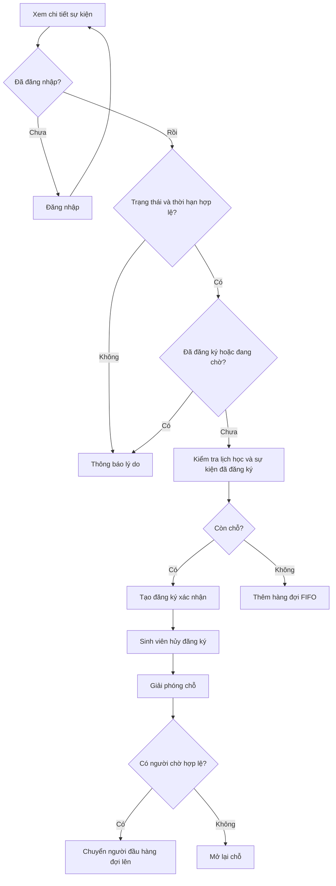
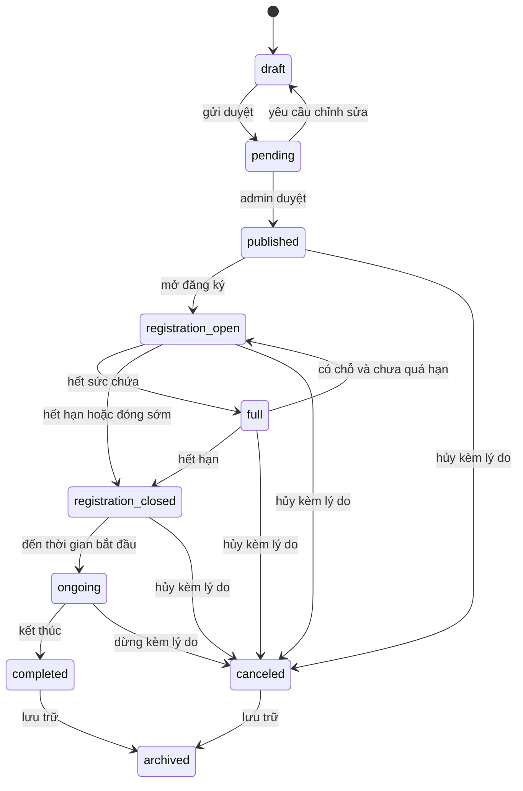

# HUTECH Event Intelligence — phân tích và thiết kế

Ngày cập nhật: 16/10/2026. Đây là thiết kế nghiệp vụ và ERD dự thảo để duyệt trước khi tạo SQL migration. Bản Flutter hiện tại là prototype chạy cục bộ; chưa có Supabase, RLS hoặc máy chủ điểm danh. Phạm vi đã triển khai và cách kiểm tra nằm trong [bàn giao giai đoạn Web cục bộ](phase_2_handoff.md).

## 1. Các lựa chọn đã chốt

- Ưu tiên Flutter Web trên Chrome, bố cục co giãn cho điện thoại.
- Dùng hình người dùng cung cấp làm tham chiếu để vẽ lại biểu trưng khiên HUTECH bằng `CustomPainter`; Web dùng SVG đồng bộ có nền trong suốt. Xanh dương, vàng và trắng là bảng màu chủ đạo.
- Dùng ảnh minh họa được tạo riêng, không chữ và không watermark. Không đặt nhãn demo trên giao diện theo yêu cầu mới nhất.
- Admin có shell và menu riêng, gồm lối vào trực tiếp `Thêm sự kiện`; khu quản lý cho phép tạo, sửa, chọn ảnh, chọn loại sự kiện, đơn vị tổ chức, địa điểm, kỹ năng, sức chứa và thời gian.
- Địa điểm hiển thị: `HUTECH khu A, B` và `HUTECH khu E`. Không tích hợp Google Maps.
- Hai tài khoản cục bộ theo yêu cầu: `HA@gmail.com / 123`, `admin@gmail.com / 123`. Đây không phải tài khoản Gmail hay Supabase đã được tạo.
- Dữ liệu sự kiện, hồ sơ và lịch học ban đầu được tách trong `lib/data/prototype_seed.dart`. Danh mục khoa/viện tham khảo nguồn HUTECH trong `data_sources.md`.
- Chưa triển khai schema cuối cùng trước khi người dùng kiểm tra ERD. Các phân quyền trong Flutter chỉ điều khiển trải nghiệm; quyền dữ liệu trực tuyến phải được bảo vệ bằng RLS ở giai đoạn sau.

## 2. Phạm vi và vai trò

| Vai trò | Use case đích | Phạm vi bản cục bộ |
|---|---|---|
| Khách | Xem, tìm, lọc sự kiện công khai; đọc chi tiết; đăng nhập | Khám phá và đọc sự kiện; đăng nhập với hai tài khoản được yêu cầu |
| Sinh viên | Hồ sơ, sở thích, lịch học, mục tiêu nghề nghiệp, đăng ký/hủy/chờ, yêu thích, đề xuất, vé, đánh giá, chứng nhận | Duyệt luồng cá nhân bằng dữ liệu cục bộ; dữ liệu không đồng bộ giữa máy |
| Ban tổ chức | Soạn sự kiện được phân công, gửi duyệt, quản lý người tham gia, điểm danh và thống kê | Thiết kế vai trò; chưa có tài khoản ban tổ chức hay quyền RLS |
| Admin | Toàn quyền trong phạm vi prototype cục bộ: dashboard, tạo/sửa/hủy/lưu trữ sự kiện, ảnh, danh mục, người dùng, đăng ký và báo cáo hiện có | Shell quản trị tách khỏi menu sinh viên, có mục `Thêm sự kiện` trực tiếp; các quyền trực tuyến, nhật ký tin cậy và báo cáo chính thức còn ở giai đoạn sau |

## 3. Luồng trải nghiệm

1. Khách mở trang chủ, tìm kiếm theo từ khóa/chủ đề, xem chi tiết.
2. Sinh viên đăng nhập, cập nhật khoa, mục tiêu, kỹ năng tự khai báo và sở thích.
3. Sinh viên nhập lịch học, chọn khung giờ rảnh và cơ sở ưu tiên.
4. Hệ thống tính điểm phù hợp bằng quy tắc có giải thích; cảnh báo xung đột lịch và thời gian di chuyển dự kiến.
5. Đăng ký kiểm tra trạng thái, hạn đăng ký, đăng ký trùng và sức chứa. Khi đủ chỗ, sinh viên được đưa vào danh sách chờ.
6. Hủy chỗ sẽ xét người đầu danh sách chờ. Việc đăng ký/hủy không tự chứng nhận kỹ năng hay tạo điểm danh.
7. Admin tạo/sửa sự kiện và ảnh; sự kiện công khai có thể được sinh viên xem ngay trong cùng kho dữ liệu cục bộ.
8. Bản trực tuyến sẽ kiểm tra các bước nhạy cảm ở máy chủ, ghi nhật ký và phát thông báo.



## 4. Vòng đời sự kiện đích



Trạng thái được lưu trong model để kiểm tra điều kiện; việc tự chuyển theo đồng hồ máy chủ, phê duyệt và thông báo là nghiệp vụ backend cần triển khai riêng. Không dùng thời gian trên máy người dùng làm cơ sở quyết định điểm danh chính thức.

## 5. Đề xuất và lịch cá nhân

Phiên bản đầu sử dụng quy tắc minh bạch, không phải mô hình AI được huấn luyện. Điểm chuẩn hóa trên 100 từ năm thành phần: sở thích 30%, kỹ năng còn thiếu 25%, lịch trống 20%, lịch sử tương tác 15%, cơ sở ưu tiên 10%. Trọng số và khoảng đệm di chuyển có thể đổi trong `lib/config/recommendation_config.dart`.

- Kỹ năng thiếu = kỹ năng mục tiêu nghề nghiệp trừ kỹ năng người học khai báo.
- Điểm kỹ năng = số kỹ năng thiếu được sự kiện hỗ trợ / tổng kỹ năng còn thiếu.
- Sở thích, lịch trống, lịch sử cùng chủ đề, cơ sở ưu tiên hiện là tín hiệu nhị phân.
- Khoảng đệm di chuyển giữa hai cơ sở là tham số kế hoạch 45 phút, không phải thời gian Google Maps hoặc kết quả đo giao thông.
- Chỉ phân tích lịch và tương tác đang có trong kho cục bộ. Chưa có dữ liệu không được diễn giải thành bằng chứng người học chắc chắn rảnh.
- Không cộng năng lực được xác nhận chỉ vì sinh viên đăng ký. Kỹ năng tự khai báo cần phân biệt với minh chứng điểm danh/đánh giá trong backend tương lai.
- Các biểu đồ hiện tại phải tính từ dữ liệu đang có; chưa có điểm danh/đánh giá thì không suy ra hiệu quả sự kiện.

## 6. ERD dự thảo

Mọi bảng nghiệp vụ dự kiến dùng UUID cho `id`, `created_at`, `updated_at` với thời gian máy chủ. ERD dưới đây lược bớt hai cột thời gian để dễ đọc. `profiles.id` tham chiếu `auth.users.id`; không tạo bảng mật khẩu riêng. Các bảng nối dùng UUID và unique constraint cho cặp khóa ngoại. Dữ liệu cục bộ hiện tại chưa phải cấu trúc vật lý PostgreSQL này.

```mermaid
erDiagram
    profiles {
        uuid id PK
        uuid faculty_id FK
        uuid major_id FK
        string full_name
        string student_code UK
        string cohort
    }
    roles {
        uuid id PK
        string code UK
        string name
    }
    user_roles {
        uuid id PK
        uuid profile_id FK
        uuid role_id FK
    }
    faculties {
        uuid id PK
        string code UK
        string name
    }
    majors {
        uuid id PK
        uuid faculty_id FK
        string code UK
        string name
    }
    organizations {
        uuid id PK
        uuid faculty_id FK
        string name
        string kind
    }
    venues {
        uuid id PK
        string name
        string campus
        string address
    }
    event_categories {
        uuid id PK
        string name UK
    }
    events {
        uuid id PK
        uuid organization_id FK
        uuid category_id FK
        uuid venue_id FK
        uuid created_by FK
        string code UK
        string title
        string status
        timestamp start_at
        timestamp end_at
        timestamp registration_deadline
        int capacity
        timestamp deleted_at
    }
    event_organizers {
        uuid id PK
        uuid event_id FK
        uuid profile_id FK
    }
    event_audiences {
        uuid id PK
        uuid event_id FK
        uuid faculty_id FK
        uuid major_id FK
    }
    event_images {
        uuid id PK
        uuid event_id FK
        string storage_path
        int sort_order
        bool is_cover
    }
    interests {
        uuid id PK
        string name UK
    }
    user_interests {
        uuid id PK
        uuid profile_id FK
        uuid interest_id FK
    }
    event_interests {
        uuid id PK
        uuid event_id FK
        uuid interest_id FK
    }
    skills {
        uuid id PK
        string name UK
        string skill_group
    }
    career_goals {
        uuid id PK
        string name UK
    }
    career_goal_skills {
        uuid id PK
        uuid career_goal_id FK
        uuid skill_id FK
        int required_level
    }
    user_career_goals {
        uuid id PK
        uuid profile_id FK
        uuid career_goal_id FK
        bool is_primary
    }
    event_skills {
        uuid id PK
        uuid event_id FK
        uuid skill_id FK
        string evidence_rule
    }
    user_skill_evidence {
        uuid id PK
        uuid profile_id FK
        uuid skill_id FK
        uuid attendance_record_id FK
        uuid assessment_result_id FK
        string source_type
        string verification_status
        int level
    }
    schedules {
        uuid id PK
        uuid profile_id FK
        uuid venue_id FK
        string title
        int weekday
        time starts_at
        time ends_at
        date valid_from
        date valid_to
    }
    registrations {
        uuid id PK
        uuid profile_id FK
        uuid event_id FK
        string status
        timestamp canceled_at
    }
    waitlist {
        uuid id PK
        uuid registration_id FK
        timestamp joined_at
        timestamp promoted_at
    }
    attendance_sessions {
        uuid id PK
        uuid event_id FK
        uuid opened_by FK
        timestamp opens_at
        timestamp closes_at
        string status
    }
    attendance_tokens {
        uuid id PK
        uuid session_id FK
        uuid registration_id FK
        string token_hash UK
        timestamp expires_at
        timestamp consumed_at
    }
    attendance_records {
        uuid id PK
        uuid session_id FK
        uuid registration_id FK
        uuid recorded_by FK
        timestamp checked_in_at
        string method
        string manual_reason
    }
    assessments {
        uuid id PK
        uuid event_id FK
        string phase
        string title
        timestamp closes_at
    }
    assessment_questions {
        uuid id PK
        uuid assessment_id FK
        string question_text
        string question_type
        int display_order
        decimal max_score
    }
    assessment_options {
        uuid id PK
        uuid question_id FK
        string option_text
        bool is_correct
    }
    assessment_results {
        uuid id PK
        uuid assessment_id FK
        uuid registration_id FK
        decimal score
        timestamp submitted_at
    }
    assessment_answers {
        uuid id PK
        uuid result_id FK
        uuid question_id FK
        uuid selected_option_id FK
        string answer_text
        decimal awarded_score
    }
    event_feedback {
        uuid id PK
        uuid registration_id FK
        int rating
        string comment
    }
    favorites {
        uuid id PK
        uuid profile_id FK
        uuid event_id FK
    }
    event_views {
        uuid id PK
        uuid profile_id FK
        uuid event_id FK
        timestamp viewed_at
    }
    notifications {
        uuid id PK
        uuid profile_id FK
        uuid event_id FK
        string title
        string body
        timestamp read_at
    }
    certificates {
        uuid id PK
        uuid registration_id FK
        uuid issued_by FK
        string code UK
        string storage_path
        timestamp issued_at
        timestamp revoked_at
    }
    audit_logs {
        uuid id PK
        uuid actor_id FK
        string action
        string entity_type
        uuid entity_id
        string outcome
        string reason
    }
    profiles ||--o{ user_roles : has
    roles ||--o{ user_roles : grants
    faculties ||--o{ profiles : groups
    faculties ||--o{ majors : offers
    majors ||--o{ profiles : studies
    faculties o|--o{ organizations : includes
    organizations ||--o{ events : organizes
    event_categories ||--o{ events : classifies
    venues ||--o{ events : hosts
    profiles ||--o{ events : creates
    events ||--o{ event_organizers : assigns
    profiles ||--o{ event_organizers : manages
    events ||--o{ event_audiences : targets
    faculties o|--o{ event_audiences : limits
    majors o|--o{ event_audiences : limits
    events ||--o{ event_images : illustrates
    profiles ||--o{ user_interests : selects
    interests ||--o{ user_interests : selected
    events ||--o{ event_interests : covers
    interests ||--o{ event_interests : matches
    career_goals ||--o{ career_goal_skills : requires
    skills ||--o{ career_goal_skills : required
    profiles ||--o{ user_career_goals : chooses
    career_goals ||--o{ user_career_goals : chosen
    events ||--o{ event_skills : supports
    skills ||--o{ event_skills : supported
    profiles ||--o{ schedules : owns
    venues ||--o{ schedules : hosts
    profiles ||--o{ registrations : registers
    events ||--o{ registrations : receives
    registrations ||--o| waitlist : queues
    events ||--o{ attendance_sessions : schedules
    profiles ||--o{ attendance_sessions : opens
    attendance_sessions ||--o{ attendance_tokens : issues
    registrations ||--o{ attendance_tokens : holds
    attendance_sessions ||--o{ attendance_records : records
    registrations ||--o| attendance_records : attends
    profiles ||--o{ attendance_records : records
    events ||--o{ assessments : evaluates
    assessments ||--o{ assessment_questions : contains
    assessment_questions ||--o{ assessment_options : offers
    assessments ||--o{ assessment_results : receives
    registrations ||--o{ assessment_results : submits
    assessment_results ||--o{ assessment_answers : contains
    assessment_questions ||--o{ assessment_answers : answers
    assessment_options o|--o{ assessment_answers : selects
    profiles ||--o{ user_skill_evidence : owns
    skills ||--o{ user_skill_evidence : proves
    attendance_records o|--o{ user_skill_evidence : supports
    assessment_results o|--o{ user_skill_evidence : supports
    registrations ||--o| event_feedback : reviews
    profiles ||--o{ favorites : saves
    events ||--o{ favorites : saved
    profiles ||--o{ event_views : views
    events ||--o{ event_views : viewed
    profiles ||--o{ notifications : receives
    events o|--o{ notifications : concerns
    registrations ||--o| certificates : qualifies
    profiles ||--o{ certificates : issues
    profiles o|--o{ audit_logs : acts
```



### Ràng buộc cần triển khai sau khi duyệt

- Unique: `(profile_id, event_id)` trên registrations và favorites; `(profile_id, role_id)` trên user_roles; mọi cặp khóa trên bảng nối; một hàng đợi/đăng ký; một phản hồi/đăng ký; một điểm danh/đăng ký; một kết quả/đăng ký/bài đánh giá.
- Khi đăng ký lại sau hủy, cập nhật cùng registration thay vì tạo hàng vi phạm unique; mọi thay đổi được ghi audit log.
- `capacity > 0`, `start_at < end_at`, `registration_deadline <= start_at`, `rating` trong 1–5, điểm bài đánh giá không âm; valid_from không sau valid_to.
- Transaction đăng ký/hủy/chuyển hàng đợi khóa dữ liệu liên quan để không vượt sức chứa khi hai người cùng đăng ký. Thứ tự FIFO dựa trên thời gian máy chủ và UUID làm tiêu chí phụ.
- Index mọi FK; index `(status, start_at)`, `(event_id, status)`, `(profile_id, read_at)`, hàng đợi theo joined_at; tìm kiếm có dấu/không dấu cần cấu hình PostgreSQL rõ ràng.
- Soft delete sự kiện, hồ sơ danh mục khi phù hợp; không xóa cứng điểm danh, đăng ký và chứng nhận đã cấp.
- Trường hợp nhiều lựa chọn trong một câu hỏi sẽ bổ sung bảng nối answer_options trước khi chốt SQL; ERD hiện biểu diễn một lựa chọn hoặc câu trả lời văn bản.
- `audit_logs.entity_id` là tham chiếu đa loại, không phải FK trực tiếp. Log chỉ máy chủ ghi, không cho client tự sửa/xóa.
- Sự kiện của phiên điểm danh và đăng ký phải trùng nhau. Kiểm tra token một lần, thời hạn, đăng ký hợp lệ và cửa sổ điểm danh trong cùng transaction.
- Quy tắc cấp chứng nhận và mức kỹ năng phải được người dùng xác nhận trước khi triển khai; bản cục bộ không tạo chứng nhận HUTECH.

## 7. Ma trận quyền backend dự kiến

| Dữ liệu | Khách | Sinh viên | Ban tổ chức | Admin |
|---|---|---|---|---|
| Sự kiện công khai, danh mục | Đọc | Đọc | Đọc | Quản lý |
| Hồ sơ, lịch, sở thích, mục tiêu | Không | Chỉ dữ liệu của mình | Chỉ hồ sơ của mình | Quyền tối thiểu theo nghiệp vụ |
| Nháp và chỉnh sửa sự kiện | Không | Không | Chỉ sự kiện được phân công | Tất cả |
| Đăng ký và hàng đợi | Không | Đọc dữ liệu mình; mutation qua RPC | Đọc trong sự kiện phụ trách | Quản lý theo nghiệp vụ |
| Điểm danh, token | Không | Nhận vé/điểm danh của mình qua RPC | Mở phiên/điểm danh có lý do trong phạm vi phụ trách | Kiểm soát và kiểm tra log |
| Đáp án đúng, điểm và minh chứng | Không | Đọc kết quả của mình, không tự chấm | Quản lý bài được phân công | Quản lý |
| Vai trò và nhật ký | Không | Không tự nâng quyền | Không tự nâng quyền | Chức năng tin cậy trên máy chủ |

RLS là điều kiện cần, không thay thế transaction. Không dùng metadata do sinh viên chỉnh sửa làm căn cứ cấp quyền. `service_role` và secret key chỉ tồn tại ở môi trường máy chủ được kiểm soát.

## 8. Kiến trúc và package

```text
lib/
  main.dart                  # khởi động
  app/                       # theme, routing, responsive shell
  config/                    # trọng số đề xuất và cấu hình
  data/                      # dữ liệu khởi tạo riêng
  models/                    # model, enum, JSON
  providers/                 # trạng thái chia sẻ
  repositories/              # adapter lưu cục bộ; thay bằng Supabase sau
  services/                  # đăng ký, đề xuất, xung đột lịch, auth
  screens/auth/              # đăng nhập và trạng thái tài khoản
  screens/public/            # khám phá và chi tiết
  screens/student/           # lịch, hồ sơ, năng lực, lộ trình
  screens/admin/             # quản lý sự kiện, ảnh, danh mục
  widgets/                   # thành phần dùng lại
docs/                        # thiết kế, nguồn dữ liệu, đối chiếu học phần
test/                        # unit và widget tests
```

Package dùng cho bản cục bộ: Provider, go_router, SharedPreferences, intl, carousel_slider, table_calendar, image_picker, fl_chart, qr_flutter, pdf, printing và flutter_localizations. `carousel_slider` đảm nhiệm banner tự chuyển mỗi 3 giây, cùng mũi tên và chỉ báo trang. Chạm/giữ hoặc đặt chuột trên banner sẽ dừng ảnh; sau khi kết thúc tương tác, carousel chờ 5 giây rồi tiếp tục. Đối chiếu chức năng thực tế trong `flutter_course_mapping.md` và nguồn học liệu trong `drive_curriculum_review.md`. Supabase và scanner chống gian lận chưa được coi là hoàn thành chỉ vì đã được thiết kế.

Bản hiện tại không gọi API nghiệp vụ bên ngoài. `LocalAuthService` xác thực hai tài khoản cục bộ; `LocalRepository` lưu JSON bằng IndexedDB trên web và tệp trong Application Support trên Android/desktop, đồng thời tự chuyển bản SharedPreferences cũ. Ảnh seed nằm trong asset và ảnh admin chọn được đọc từ máy. PDF, QR, biểu đồ và lịch được tạo từ dữ liệu cục bộ. Widget ảnh có nhánh `Image.network` dành cho URL HTTPS tương lai, nhưng seed và form hiện tại không dùng nhánh này. Supabase, REST backend, Google Maps và API key đều chưa có trong runtime hiện tại.

## 9. Kiểm tra và các giai đoạn tiếp theo

Prototype cần được kiểm tra trên Chrome với màn hình desktop và điện thoại: tìm/lọc, đăng nhập hai vai trò, đăng ký/hủy/chờ, lịch học, quản lý ảnh và sự kiện, tải lại trang và kiểm tra quyền điều hướng. Unit test kiểm tra logic đăng ký, thời hạn, FIFO, xung đột và điểm đề xuất; widget test kiểm tra luồng quan trọng khi đã triển khai.

Sau khi duyệt giao diện và ERD: tạo migration/RLS, kết nối Supabase Auth/Database/Storage, thay kho cục bộ, kiểm thử với ít nhất hai sinh viên và hai người tổ chức. Sau đó triển khai đánh giá trước/sau, QR có hạn và một lần dùng, camera/mã dự phòng, log máy chủ, chứng nhận và báo cáo. Chỉ đánh dấu hoàn thành sau khi từng chức năng chạy và được kiểm thử; không dùng số liệu tự tạo để tuyên bố hiệu quả thuật toán.
